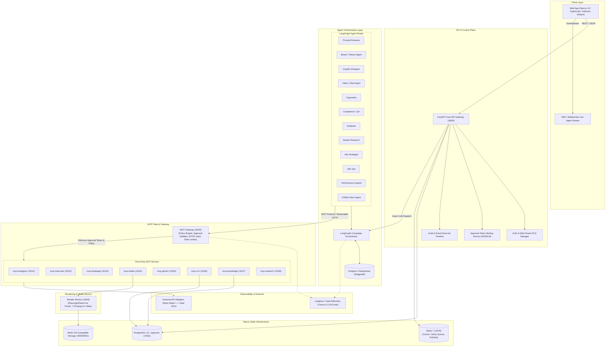

# AI Marketing Employee — Master Planning Artifact (POC Architecture)

> **Document Status:** Planning & Architecture Baseline (Pre-Phase 0)  
> **Target Environment:** Local / Docker Compose (Non-AWS POC)  
> **Author:** Principal Engineer & Systems Architect  
> **Review Requirement:** User approval required before Phase 0 initialization.

---

## 1. System Architecture Diagram

This architecture adapts the production vision specifically for a **clean, reproducible, non-AWS POC setup**. All AWS services (S3, KMS, ECS/Fargate, CloudWatch) are replaced with open-source, local-first equivalents:
- **Storage:** MinIO (S3-compatible object storage) with signed URL generation.
- **Secrets & Vault:** AES-256-GCM envelope encryption using a local master secret (`APP_MASTER_KEY`).
- **Compute/Runtime:** Docker Compose container fleet with shared network and volume mounts.
- **Orchestration & Queue:** Redis + Celery / async worker runtime with LangGraph checkpointing in PostgreSQL.



---

## 2. Monorepo Repository Tree

The monorepo separates concerns into clean application layers, shared core libraries, and isolated MCP servers:

```text
possible-studio-automation/
├── docker-compose.yml              # Local infrastructure (Postgres+vector, Redis, MinIO, Langfuse)
├── docker-compose.override.yml.example
├── .env.example                    # Master env template (mock keys enabled by default)
├── Makefile                        # Dev commands: up, test, lint, migrate, seed
├── pyproject.toml                  # Workspace root UV/Poetry config
├── package.json                    # Workspace root pnpm config
├── docs/                           # Architecture, RFCs, and ADRs
│   ├── Architecture.md
│   ├── planning_artifact.md
│   └── adrs/
├── apps/
│   ├── web/                        # Next.js 14 App Router (Tailwind, shadcn/ui, TanStack Query)
│   │   ├── src/
│   │   │   ├── app/                # App router pages (dashboard, campaigns, review, inbox)
│   │   │   ├── components/         # Design system & workflow components
│   │   │   ├── hooks/              # SSE client hooks, campaign polling
│   │   │   └── lib/                # API client, types
│   │   └── Dockerfile
│   ├── api/                        # FastAPI main control plane
│   │   ├── app/
│   │   │   ├── api/v1/             # Endpoints (auth, workspaces, campaigns, approvals)
│   │   │   ├── core/               # Config, security, database session
│   │   │   ├── models/             # SQLAlchemy 2 models with RLS hooks
│   │   │   ├── schemas/            # Pydantic v2 schemas
│   │   │   ├── services/           # Approval token minter, timeline emitter, billing hooks
│   │   │   └── main.py
│   │   ├── alembic/                # Database migrations
│   │   └── Dockerfile
│   ├── agent-runtime/              # LangGraph worker & graph definitions
│   │   ├── graphs/                 # Campaign graph, Creative graph, Inbox graph
│   │   ├── agents/                 # 12 Agent implementations
│   │   ├── state/                  # LangGraph typed state definitions
│   │   ├── worker.py               # Background job runner
│   │   └── Dockerfile
│   ├── mcp-gateway/                # Tool router, policy checker, BYOK vault
│   │   ├── gateway/
│   │   │   ├── router.py           # Capability-to-server resolution
│   │   │   ├── policy.py           # Risk checking, approval token validation
│   │   │   ├── vault.py            # Local envelope-encrypted credential manager
│   │   │   └── server.py
│   │   └── Dockerfile
│   ├── render-service/             # Poster (Satori/Playwright) & Video (FFmpeg)
│   │   ├── poster/                 # HTML/SVG/Tailwind templates driven by design tokens
│   │   ├── video/                  # FFmpeg pipeline: 9:16 compositing, audio, subtitles
│   │   ├── app.py
│   │   └── Dockerfile
│   ├── webhook-service/            # Inbound Meta/WhatsApp webhook receiver
│   │   ├── handlers/               # Signature verification, idempotency deduplication
│   │   └── app.py
│   └── scheduler/                  # Scheduled metrics sync, publish trigger
├── packages/
│   ├── mcp-common/                 # Shared Python MCP library
│   │   ├── src/mcp_common/
│   │   │   ├── server.py           # Base MCP server with Streamable HTTP transport
│   │   │   ├── auth.py             # Tenant context propagation
│   │   │   ├── approval.py         # Signature & hash-bound approval validation
│   │   │   ├── errors.py           # Standardized error hierarchy
│   │   │   ├── telemetry.py        # OTel and Langfuse instrumentation
│   │   │   └── mocks.py            # Base mock adapter harness
│   │   └── pyproject.toml
│   └── model-gateway/              # Provider-agnostic LLM/Vision/Embedding Gateway
│       ├── src/model_gateway/
│       │   ├── gateway.py          # Unified client (Gemini, Claude, Mock)
│       │   ├── cost_tracker.py     # Per-tenant token and cost accounting
│       │   └── structured.py       # Pydantic schema structured output enforcement
│       └── pyproject.toml
└── mcp-servers/                    # Standalone, first-party MCP servers
    ├── mcp-instagram/              # Graph API wrapper + Mock
    ├── mcp-meta-ads/               # Marketing API wrapper + Budget guardrails + Mock
    ├── mcp-whatsapp/               # WhatsApp Cloud API wrapper + Mock
    ├── mcp-media/                  # Calls render-service + Mock
    ├── mcp-gemini/                 # BYOK & Platform Gemini wrapper + Mock
    ├── mcp-crm/                    # Lightweight multi-tenant CRM + Mock
    ├── mcp-knowledge/              # Brand kit RAG + Token retriever
    └── mcp-research/               # Scraper & Meta Ad Library search + Mock
```

---

## 3. Database Schema (PostgreSQL 16 + pgvector)

All multi-tenant tables enforce `tenant_id` isolation via PostgreSQL Row-Level Security (`RLS`).

```sql
-- 1. Tenants & Workspaces
CREATE TABLE tenants (
    id UUID PRIMARY KEY DEFAULT gen_random_uuid(),
    name VARCHAR(255) NOT NULL,
    slug VARCHAR(100) UNIQUE NOT NULL,
    daily_budget_limit_cents BIGINT DEFAULT 100000, -- Default $1,000 cap
    lifetime_budget_limit_cents BIGINT DEFAULT 500000,
    created_at TIMESTAMPTZ DEFAULT NOW(),
    updated_at TIMESTAMPTZ DEFAULT NOW()
);

CREATE TABLE users (
    id UUID PRIMARY KEY DEFAULT gen_random_uuid(),
    email VARCHAR(255) UNIQUE NOT NULL,
    full_name VARCHAR(255) NOT NULL,
    password_hash VARCHAR(255) NOT NULL,
    created_at TIMESTAMPTZ DEFAULT NOW()
);

CREATE TABLE workspace_memberships (
    id UUID PRIMARY KEY DEFAULT gen_random_uuid(),
    tenant_id UUID REFERENCES tenants(id) ON DELETE CASCADE,
    user_id UUID REFERENCES users(id) ON DELETE CASCADE,
    role VARCHAR(50) NOT NULL CHECK (role IN ('OWNER', 'EDITOR', 'APPROVER', 'VIEWER')),
    created_at TIMESTAMPTZ DEFAULT NOW(),
    UNIQUE(tenant_id, user_id)
);

-- 2. Brand Kits & Design System Tokens
CREATE TABLE brand_kits (
    id UUID PRIMARY KEY DEFAULT gen_random_uuid(),
    tenant_id UUID NOT NULL REFERENCES tenants(id) ON DELETE CASCADE,
    brand_name VARCHAR(255) NOT NULL,
    logo_url TEXT,
    palette_tokens JSONB NOT NULL,    -- { primary, secondary, accent, surface, text }
    typography_tokens JSONB NOT NULL,-- { headline_font, body_font, weights }
    tone_of_voice JSONB NOT NULL,     -- { keywords, do, dont, samples }
    product_catalog JSONB DEFAULT '[]'::JSONB,
    version INT NOT NULL DEFAULT 1,
    is_active BOOLEAN DEFAULT TRUE,
    created_at TIMESTAMPTZ DEFAULT NOW()
);

CREATE TABLE brand_knowledge_embeddings (
    id UUID PRIMARY KEY DEFAULT gen_random_uuid(),
    tenant_id UUID NOT NULL REFERENCES tenants(id) ON DELETE CASCADE,
    brand_kit_id UUID REFERENCES brand_kits(id) ON DELETE CASCADE,
    content_chunk TEXT NOT NULL,
    category VARCHAR(50), -- 'faq', 'policy', 'product_spec', 'voice_sample'
    embedding vector(768), -- Gemini Text Embedding 768-dim
    created_at TIMESTAMPTZ DEFAULT NOW()
);

-- 3. Campaigns & Creative Briefs
CREATE TABLE campaigns (
    id UUID PRIMARY KEY DEFAULT gen_random_uuid(),
    tenant_id UUID NOT NULL REFERENCES tenants(id) ON DELETE CASCADE,
    title VARCHAR(255) NOT NULL,
    raw_prompt TEXT NOT NULL,
    status VARCHAR(50) NOT NULL DEFAULT 'DRAFT', -- DRAFT, PLANNING, CREATIVE, REVIEW, PUBLISHED, RUNNING, COMPLETED
    current_step VARCHAR(50) NOT NULL DEFAULT 'PROMPT_ENHANCEMENT',
    created_by UUID REFERENCES users(id),
    created_at TIMESTAMPTZ DEFAULT NOW(),
    updated_at TIMESTAMPTZ DEFAULT NOW()
);

CREATE TABLE creative_briefs (
    id UUID PRIMARY KEY DEFAULT gen_random_uuid(),
    campaign_id UUID NOT NULL REFERENCES campaigns(id) ON DELETE CASCADE,
    tenant_id UUID NOT NULL REFERENCES tenants(id) ON DELETE CASCADE,
    objective VARCHAR(100) NOT NULL,
    product_focus TEXT NOT NULL,
    target_audience JSONB NOT NULL,
    tone VARCHAR(100) NOT NULL,
    deliverables VARCHAR(50) NOT NULL CHECK (deliverables IN ('POSTER', 'REEL', 'BOTH')),
    channels TEXT[] DEFAULT ARRAY['INSTAGRAM'],
    call_to_action TEXT NOT NULL,
    constraints TEXT[],
    enhanced_prompt TEXT NOT NULL,
    version INT DEFAULT 1,
    is_approved BOOLEAN DEFAULT FALSE,
    created_at TIMESTAMPTZ DEFAULT NOW()
);

-- 4. Assets & Rendered Variants
CREATE TABLE creative_assets (
    id UUID PRIMARY KEY DEFAULT gen_random_uuid(),
    campaign_id UUID NOT NULL REFERENCES campaigns(id) ON DELETE CASCADE,
    tenant_id UUID NOT NULL REFERENCES tenants(id) ON DELETE CASCADE,
    asset_type VARCHAR(50) NOT NULL CHECK (asset_type IN ('POSTER', 'REEL')),
    variant_index INT NOT NULL DEFAULT 1,
    storage_key TEXT NOT NULL,         -- MinIO key
    preview_url TEXT NOT NULL,
    aspect_ratio VARCHAR(20) NOT NULL, -- '1:1', '4:5', '9:16'
    layout_spec JSONB NOT NULL,        -- Deterministic rendering specification
    copy_captions JSONB NOT NULL,      -- { caption, hashtags, alt_text }
    compliance_status VARCHAR(50) NOT NULL DEFAULT 'PENDING', -- PENDING, PASSED, WARN, FAILED
    compliance_report JSONB,
    created_at TIMESTAMPTZ DEFAULT NOW()
);

-- 5. Human Approvals & Cryptographic Action Tokens
CREATE TABLE approval_requests (
    id UUID PRIMARY KEY DEFAULT gen_random_uuid(),
    campaign_id UUID NOT NULL REFERENCES campaigns(id) ON DELETE CASCADE,
    tenant_id UUID NOT NULL REFERENCES tenants(id) ON DELETE CASCADE,
    action_type VARCHAR(100) NOT NULL, -- 'INSTAGRAM_PUBLISH', 'META_ADS_LAUNCH', 'BUDGET_UPDATE'
    action_payload_hash VARCHAR(64) NOT NULL, -- SHA-256 of canonical action JSON payload
    action_payload JSONB NOT NULL,
    status VARCHAR(50) NOT NULL DEFAULT 'PENDING', -- PENDING, APPROVED, REJECTED, EXPIRED
    requested_by UUID REFERENCES users(id),
    reviewed_by UUID REFERENCES users(id),
    review_comments TEXT,
    expires_at TIMESTAMPTZ NOT NULL,
    created_at TIMESTAMPTZ DEFAULT NOW(),
    updated_at TIMESTAMPTZ DEFAULT NOW()
);

CREATE TABLE approval_tokens (
    id UUID PRIMARY KEY DEFAULT gen_random_uuid(),
    approval_request_id UUID NOT NULL REFERENCES approval_requests(id) ON DELETE CASCADE,
    tenant_id UUID NOT NULL REFERENCES tenants(id) ON DELETE CASCADE,
    token_jti VARCHAR(64) UNIQUE NOT NULL,
    payload_hash VARCHAR(64) NOT NULL,
    signature TEXT NOT NULL, -- Ed25519 signature
    is_consumed BOOLEAN DEFAULT FALSE,
    consumed_at TIMESTAMPTZ,
    expires_at TIMESTAMPTZ NOT NULL,
    created_at TIMESTAMPTZ DEFAULT NOW()
);

-- 6. Meta Ads & Instagram Live State
CREATE TABLE published_posts (
    id UUID PRIMARY KEY DEFAULT gen_random_uuid(),
    tenant_id UUID NOT NULL REFERENCES tenants(id) ON DELETE CASCADE,
    campaign_id UUID NOT NULL REFERENCES campaigns(id),
    asset_id UUID NOT NULL REFERENCES creative_assets(id),
    external_post_id VARCHAR(255) NOT NULL,
    permalink TEXT NOT NULL,
    published_at TIMESTAMPTZ NOT NULL,
    insights JSONB DEFAULT '{}'::JSONB
);

CREATE TABLE ad_campaigns (
    id UUID PRIMARY KEY DEFAULT gen_random_uuid(),
    tenant_id UUID NOT NULL REFERENCES tenants(id) ON DELETE CASCADE,
    campaign_id UUID NOT NULL REFERENCES campaigns(id),
    external_ad_campaign_id VARCHAR(255) NOT NULL,
    external_adset_id VARCHAR(255),
    external_ad_id VARCHAR(255),
    daily_budget_cents BIGINT NOT NULL,
    lifetime_budget_cents BIGINT,
    status VARCHAR(50) NOT NULL DEFAULT 'PAUSED', -- Hard rule: always created PAUSED
    created_at TIMESTAMPTZ DEFAULT NOW()
);

-- 7. Audit Trail & Event-Sourced Campaign Timeline
CREATE TABLE campaign_events (
    id UUID PRIMARY KEY DEFAULT gen_random_uuid(),
    campaign_id UUID NOT NULL REFERENCES campaigns(id) ON DELETE CASCADE,
    tenant_id UUID NOT NULL REFERENCES tenants(id) ON DELETE CASCADE,
    event_type VARCHAR(100) NOT NULL,
    actor_type VARCHAR(50) NOT NULL, -- 'AGENT', 'USER', 'SYSTEM'
    actor_id VARCHAR(100),
    payload JSONB NOT NULL,
    idempotency_key VARCHAR(100),
    created_at TIMESTAMPTZ DEFAULT NOW()
);
```

---

## 4. Agent State Schemas (LangGraph / Pydantic v2)

Agents interact through strictly typed state channels:

```python
from typing import List, Dict, Optional, Literal, Any
from pydantic import BaseModel, Field

# 1. Base Shared State
class TenantContext(BaseModel):
    tenant_id: str
    workspace_role: Literal["OWNER", "EDITOR", "APPROVER", "VIEWER"]
    user_id: str

# 2. Creative Brief State
class CreativeBriefSchema(BaseModel):
    objective: str
    product_focus: str
    target_audience: Dict[str, Any]
    tone: str
    deliverables: Literal["POSTER", "REEL", "BOTH"]
    channels: List[Literal["INSTAGRAM", "WHATSAPP", "FACEBOOK"]]
    call_to_action: str
    constraints: List[str] = Field(default_factory=list)
    enhanced_prompt: str

# 3. Graphic Layout & Rendering Specification
class TextElement(BaseModel):
    content: str
    font_family: str
    font_size: int
    font_weight: str
    color: str
    x_percent: float
    y_percent: float
    max_width_percent: float
    alignment: Literal["left", "center", "right"]

class LayoutSpecSchema(BaseModel):
    aspect_ratio: Literal["1:1", "4:5", "9:16"]
    background_image_prompt: str
    generated_image_url: Optional[str] = None
    logo_position: Dict[str, float]  # { x, y, scale }
    headline: TextElement
    subheadline: Optional[TextElement] = None
    cta_button: TextElement
    brand_tokens_applied: Dict[str, str]

# 4. Compliance & QA State
class ComplianceReportSchema(BaseModel):
    passed: bool
    text_legibility_score: float  # 0.0 - 1.0
    safe_zones_respected: bool
    brand_color_match: bool
    policy_risk_level: Literal["NONE", "LOW", "MEDIUM", "HIGH"]
    prohibited_claims_found: List[str]
    remediation_suggestions: List[str]

# 5. Master Orchestrator State for LangGraph
class CampaignGraphState(BaseModel):
    tenant_context: TenantContext
    campaign_id: str
    raw_prompt: str
    brief: Optional[CreativeBriefSchema] = None
    brief_approved: bool = False
    
    # Creative Generation
    poster_specs: List[LayoutSpecSchema] = Field(default_factory=list)
    rendered_assets: List[Dict[str, Any]] = Field(default_factory=list)
    compliance_reports: List[ComplianceReportSchema] = Field(default_factory=list)
    
    # Review Gate (LangGraph Interrupt checkpoint)
    approval_granted: bool = False
    approval_token: Optional[str] = None
    change_requests: List[str] = Field(default_factory=list)
    
    # Publication & Ad Execution
    publish_result: Optional[Dict[str, Any]] = None
    ads_strategy: Optional[Dict[str, Any]] = None
    ad_execution_result: Optional[Dict[str, Any]] = None
    
    # Event Stream Log
    timeline: List[Dict[str, Any]] = Field(default_factory=list)
```

---

## 5. Complete First-Party MCP Tool Catalog

Every tool is strictly defined with risk classifications and cryptographic approval requirements:

| MCP Server | Tool Name | Description | Risk Class | Requires Approval? | Idempotent? | Cost Class |
|---|---|---|---|:---:|:---:|:---:|
| **`mcp-instagram`** | `create_media_container` | Initializes image/carousel/reel container with Meta Graph API | WRITE | No | Yes | Low |
| | `check_container_status` | Polls upload/encoding processing status | READ | No | Yes | Free |
| | `publish_media` | Publishes media live to the Instagram Feed/Reels | **PUBLISH** | **YES** (Token required) | Yes | Low |
| | `schedule_post` | Schedules container for future publishing | **PUBLISH** | **YES** (Token required) | Yes | Low |
| | `get_post_insights` | Retrieves post reach, impressions, saves, likes | READ | No | Yes | Free |
| | `list_comments` | Retrieves recent comments on post | READ | No | Yes | Free |
| | `reply_comment` | Posts a public reply to a comment | **PUBLISH** | **YES** (or auto-reply flag) | No | Low |
| | `send_dm` | Sends a direct message to a user | WRITE | No (Subject to rate-limit) | No | Low |
| **`mcp-meta-ads`** | `list_ad_accounts` | Retrieves accessible Meta ad accounts | READ | No | Yes | Free |
| | `estimate_reach` | Returns estimated audience reach given targeting | READ | No | Yes | Free |
| | `create_campaign` | Creates ad campaign (**always PAUSED**) | WRITE | No | Yes | Low |
| | `create_adset` | Creates ad set with audience and budget | WRITE | No | Yes | Low |
| | `create_ad` | Binds creative and copy to ad set (**PAUSED**) | WRITE | No | Yes | Low |
| | `set_status` | Activates/pauses campaign or ad set | **SPEND** | **YES** (Token required) | Yes | High |
| | `update_budget` | Modifies daily or lifetime budget | **SPEND** | **YES** (Token required) | Yes | High |
| | `get_insights` | Pulls CTR, CPC, CPA, ROAS, spend metrics | READ | No | Yes | Free |
| **`mcp-whatsapp`** | `list_templates` | Lists approved WhatsApp Cloud templates | READ | No | Yes | Free |
| | `send_template_message` | Sends verified business-initiated template message | **SPEND** | **YES** | Yes | Medium |
| | `send_session_message` | Sends reply within 24h active customer window | WRITE | No (Auto-reply toggle) | No | Free |
| | `mark_read` | Marks inbound message as read | WRITE | No | Yes | Free |
| | `get_media` | Downloads inbound image/audio message | READ | No | Yes | Free |
| **`mcp-media`** | `render_poster` | Composites layout spec, text, and logo via Satori | WRITE | No | Yes | Low |
| | `render_reel` | Generates 9:16 video with captions and audio | WRITE | No | Yes | Medium |
| | `get_render_status` | Checks progress of video rendering job | READ | No | Yes | Free |
| **`mcp-gemini`** | `text.generate` | Structured reasoning / copywriting generation | WRITE | No | No | Low |
| | `image.generate` | Generates background art via Imagen/Gemini | WRITE | No | No | Medium |
| | `video.generate` | Generates video clip via Veo/Gemini video model | WRITE | No | No | High |
| **`mcp-crm`** | `create_lead` | Stores qualified prospect from DM/WhatsApp | WRITE | No | Yes | Free |
| | `update_lead_stage` | Updates stage (New, Contacted, Qualified, Won) | WRITE | No | Yes | Free |
| | `add_note` | Adds transcript or sentiment summary note | WRITE | No | No | Free |
| | `search_leads` | Searches CRM contacts by phone/email/handle | READ | No | Yes | Free |
| **`mcp-knowledge`**| `search_kb` | RAG vector search across tenant brand knowledge | READ | No | Yes | Free |
| | `get_brand_tokens` | Returns active brand colors, fonts, voice rules | READ | No | Yes | Free |
| **`mcp-research`** | `web_search` | Scrapes industry trends and competitor angles | READ | No | Yes | Low |
| | `fetch_page` | Extracts clean Markdown text from reference URL | READ | No | Yes | Free |
| | `ad_library_search`| Queries active ads in target niche | READ | No | Yes | Low |

---

## 6. Core API Contracts (FastAPI Endpoints)

### Workspaces & Brand Kit
- `POST /api/v1/workspaces`: Create tenant workspace.
- `GET /api/v1/brand-kit`: Retrieve current brand design system and tokens.
- `PUT /api/v1/brand-kit`: Upsert brand assets, color palette, typography, guidelines.
- `POST /api/v1/brand-kit/compile`: Trigger embedding ingestion into pgvector.

### Campaign Lifecycle & Orchestration
- `POST /api/v1/campaigns`: Initialize campaign with `raw_prompt`.
- `POST /api/v1/campaigns/{id}/enhance`: Trigger Prompt Enhancer Agent.
- `GET /api/v1/campaigns/{id}/stream`: SSE endpoint streaming agent steps and intermediate outputs.
- `POST /api/v1/campaigns/{id}/brief`: Update or approve creative brief.
- `POST /api/v1/campaigns/{id}/generate-creative`: Trigger Graphic Designer + Copywriter.
- `GET /api/v1/campaigns/{id}/assets`: List generated variants with compliance reports.

### Approvals & Security
- `POST /api/v1/approvals/request`: Formally creates an approval request for a high-risk payload.
- `POST /api/v1/approvals/{id}/decision`: Accept/Reject by an Approver. If approved, mints an Ed25519 single-use, hash-bound token.
- `POST /api/v1/approvals/{id}/request-changes`: Submit revision notes for targeted regeneration.

### MCP Gateway Proxy & Webhooks
- `POST /api/v1/mcp/proxy/{capability}`: Internal agent tool call proxy. Validates tenant, rate limits, and approval tokens.
- `POST /api/v1/webhooks/meta`: Inbound Instagram/WhatsApp webhook receiver with SHA-256 HMAC verification.

---

## 7. Third-Party API Prerequisites & POC Strategy

| API / Provider | Required Scopes / Permissions | Production Review Horizon | POC Sandbox / Mock Strategy |
|---|---|---|---|
| **Meta Graph API (Instagram)** | `instagram_basic`, `instagram_content_publish`, `pages_manage_posts`, `instagram_manage_comments`, `instagram_manage_messages` | 2–4 weeks (Requires Meta App Review & Business Verification) | **Meta App in "Development Mode"** with Admin/Tester accounts + Full high-fidelity Mock Adapter. |
| **Meta Marketing API (Ads)** | `ads_management`, `ads_read` | Requires Standard Access approval | **Meta Sandbox Ad Account** (`act_sandbox_*`) + Mock Adapter for zero-cost simulated ad spend. |
| **WhatsApp Cloud API** | `whatsapp_business_messaging`, `whatsapp_business_management` | 1–2 weeks | **Meta WhatsApp Test Number** (provides 5 free sandbox recipients) + Mock Adapter. |
| **Google Gemini API** | Gemini 1.5 Pro / Flash API access, Imagen 3, Veo API | Instant via Google AI Studio API key | Direct API key configuration via `.env` + Mock mode for CI tests. |

---

## 8. Risk Register & Mitigation Strategy

| Risk ID | Category | Description | Severity | Mitigation Strategy |
|:---:|---|---|:---:|---|
| **R1** | Security | Prompt injection via untrusted user inputs (Instagram DMs, WhatsApp, scraped web pages). | **Critical** | Untrusted content is treated as inert string data; strictly typed extraction via Pydantic; Inbox Agent has **zero access** to `publish` or `spend` MCP tools. |
| **R2** | Financial | Accidental ad spend or runaway budget via agent loop. | **Critical** | All ads created in `PAUSED` state; hard budget limits enforced at both database and MCP server levels; `set_status=ACTIVE` requires signed single-use approval token. |
| **R3** | Security | Forgery or replay of approval tokens to trigger unauthorized publishing. | **High** | Tokens are minted using Ed25519, cryptographically hash-bound to the exact action payload, given a short TTL (15 min), and marked consumed atomically in DB. |
| **R4** | Quality | AI image model hallucinating mangled text or distorted brand logos. | **High** | Architectural separation: Gemini generates only the clean visual background; text, slogans, and vector logos are deterministically composited via Satori/Playwright. |
| **R5** | Reliability | Long-running video (FFmpeg) or image rendering times out in HTTP handlers. | **Medium** | Async decoupled worker pattern: jobs dispatched to Redis/Celery queue with SSE polling for state updates. |
| **R6** | Meta Policy | Account bans due to bot-like spammy commenting or rapid DM replies. | **High** | Strict client-side rate limiting; jitter on reply delays; human escalation on low confidence or negative sentiment. |

---

## 9. 12-Week Phased POC Implementation Roadmap

```mermaid
gantt
    title AI Marketing Employee Roadmap (Non-AWS POC)
    dateFormat  YYYY-MM-DD
    section Phase 0-2 (Foundation)
    Phase 0: Foundations, Docker, Monorepo, MCP SDK   :p0, 2026-10-13, 7d
    Phase 1: Dashboard, Brand Kit, Knowledge RAG      :p1, after p0, 7d
    Phase 2: Prompt Enhancer, Brief, Streaming UI     :p2, after p1, 7d
    section Phase 3-5 (Creative & Human Loop)
    Phase 3: Creative Generation (Poster + Satori)    :p3, after p2, 7d
    Phase 4: Reel & Video Pipeline (FFmpeg)           :p4, after p3, 7d
    Phase 5: Human-in-the-Loop & Approval Tokens     :p5, after p4, 7d
    section Phase 6-8 (Tooling & Social/Ads)
    Phase 6: MCP Gateway Hardening & BYOK Gemini      :p6, after p5, 7d
    Phase 7: Instagram Publishing Server & E2E        :p7, after p6, 7d
    Phase 8: Research & Meta Ads Sandbox              :p8, after p7, 7d
    section Phase 9-11 (Optimization & Hardening)
    Phase 9: Metrics Monitoring & Action Cards        :p9, after p8, 7d
    Phase 10: Unified Inbox (DM & WhatsApp) + CRM     :p10, after p9, 7d
    Phase 11: E2E Demo, Chaos Evals & POC Sign-off    :p11, after p10, 7d
```

- **Phase 0 (Week 1):** Monorepo structure, Docker Compose (Postgres+vector, Redis, MinIO), FastAPI base, Next.js shell, `mcp-common` SDK, Hello MCP server, and Mock LLM adapters.
- **Phase 1 (Week 2):** Brand Kit onboarding, design tokens extractor, `mcp-knowledge` with pgvector search.
- **Phase 2 (Week 3):** Prompt Enhancer Agent, structured brief generation, streaming progress UI.
- **Phase 3 (Week 4):** `mcp-media` poster compositing (Satori), Graphic Designer Agent, caption generator, 3 variants gallery.
- **Phase 4 (Week 5):** Video/Reel Agent, FFmpeg 9:16 pipeline, audio/caption sync, resumable async rendering.
- **Phase 5 (Week 6):** LangGraph human-in-the-loop interrupt, interactive review screen, Ed25519 signed approval token engine.
- **Phase 6 (Week 7):** MCP Gateway hardening, BYOK Gemini connector, policy and sandboxing engine.
- **Phase 7 (Week 8):** `mcp-instagram` server, container polling, post verification, mock & sandbox publishing.
- **Phase 8 (Week 9):** `mcp-research`, `mcp-meta-ads` server with hard budget caps, Strategy UI.
- **Phase 9 (Week 10):** Analytics warehouse, Performance Analyst Agent, one-click approvable action cards.
- **Phase 10 (Week 11):** Webhook service, unified inbox (Instagram DMs + WhatsApp), Inbox Agent with RAG, `mcp-crm`.
- **Phase 11 (Week 12):** E2E scenario testing, security audit, demo walkthrough, final POC delivery.

---

## 10. Next Immediate Action
Upon your review and explicit approval of this Planning Artifact, we will proceed directly to **Phase 0: Foundations and Planning**:
1. Scaffold the monorepo structure (`apps/`, `packages/`, `mcp-servers/`).
2. Configure `docker-compose.yml` for local Postgres (with `pgvector`), Redis, and MinIO.
3. Build the core FastAPI shell with JWT auth and multi-tenant RLS.
4. Build `packages/mcp-common` and the first "Hello World" MCP server through the gateway.
5. Provide the Next.js shell with live SSE connectivity and test suite.
